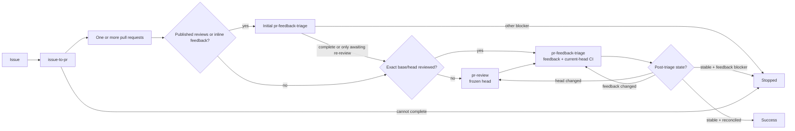

# pr-loop

> GitHub-native, race-safe Agentic Issue-Driven Development skills.

`pr-loop` provides four portable skills that can be used independently, with `pr-loop` composing the other three into an end-to-end Issue/PR loop.

- [`issue-to-pr`](skills/issue-to-pr/SKILL.md): plan one or more same-repository Issues as single, independent, or stacked PRs, then create and verify each PR.
- [`pr-review`](skills/pr-review/SKILL.md): review one frozen PR head with adaptive risk-driven analysis and verified `COMMENT` publication.
- [`pr-feedback-triage`](skills/pr-feedback-triage/SKILL.md): reconcile feedback and failed current-head CI, apply focused fixes, and finish replies/resolutions.
- [`pr-loop`](skills/pr-loop/SKILL.md): compose those phases across each PR in dependency order until every final base/head snapshot is reviewed, published feedback is reconciled, and completed CI failures are assessed.

Each standalone skill owns its own mechanics and result contract. The composite skill reuses those procedures without duplicating their policies.

## Flow



`issue-to-pr` defaults to one PR. It creates independent PRs for unrelated changes or stacked PRs when successive changes depend on earlier ones, including when an Issue explicitly requires multiple PRs. Each stack is a linear chain rooted at the target branch; independent branches remain separate. See [multi-PR behavior](skills/issue-to-pr/references/multi-pr.md).

For an existing pull request with submitted reviews or inline review comments (including feedback on earlier heads), `pr-loop` runs `pr-feedback-triage` first; otherwise it starts at review verification. A published `pr-review` is reused only when its persisted review commit and base/head markers verify the exact current pair; otherwise a new review follows triage. An initial triage stopped **only** by an active `CHANGES_REQUESTED` approval blocker can still proceed to review after all fixes and checks are verified, but cannot report success while approval remains outstanding. The entry decision is made once per PR. Only the requested PR is processed unless a requested stack can be verified. Stacked PR feedback is reconciled bottom-up; changes to a lower layer invalidate affected downstream reviews.

## Core guarantees

- Single writer: at most one repository writer is active during a mutation phase, and GitHub mutations are serialized against validated state.
- Exact implementation base: `issue-to-pr` pins the target base and each dependent layer's verified parent, and publishes fresh verified PR branches.
- Frozen-head review: `pr-review` analyzes one immutable snapshot and, when composed, publishes explicitly against that reviewed SHA.
- Live-head triage: `pr-feedback-triage` follows current head/feedback changes, diagnoses completed current-head CI failures, and rejects stale prepared actions before mutation.
- Model-directed recovery: triage autonomously diagnoses recoverable failures and chooses safe, bounded remediation without relaxing QA or publication gates.
- Final-head/base review: if triage or stack propagation changes a reviewed head or base, `pr-loop` requires another review of the affected snapshot before success.
- Fail closed: unsafe repository state, unresolved required QA/publication failures, stale state, exhausted caller limits, missing mandatory capabilities, unresolved actionable feedback, or active `CHANGES_REQUESTED` reviews stop the relevant procedure.
- No third-party wait: triage published bot/human feedback, but never await pending or running third-party reviews or future comments.
- CI remediation: completed failed checks are diagnosed and fixed when in scope; pending checks are not polled, and subsequent commits require fresh head-bound checks.
- Completion is not merge readiness: final-head CI status (passed/failed/pending/unknown), branch protection, and deployment/acceptance checks are reported separately; no protections are bypassed and no merge is implied.

## Requirements

- Git and authenticated GitHub access through `gh` or an equivalent integration.
- A coding-agent runtime with GitHub/repository access and finite loop bounds. `pr-loop` defaults to 3 review rounds per PR and 3 graph passes for multi-PR runs; `pr-feedback-triage` defaults to 9 restarts per PR.
- For GitHub-native stacked PR linkage, repository support and a suitable stack-aware client (such as `gh stack`) are required. The skills do not install tools; when unavailable, they may produce explicitly identified ordinary branch-based dependent PRs using safe repository APIs.

## Reusable workflow

Claude Code PR reviews can use the bundled reusable workflow:

```yaml
jobs:
  claude-code-review:
    permissions:
      contents: read
      pull-requests: write
      id-token: write
      actions: read
    uses: dceoy/pr-loop/.github/workflows/claude-code-review.yml@main
    secrets:
      CLAUDE_CODE_OAUTH_TOKEN: ${{ secrets.CLAUDE_CODE_OAUTH_TOKEN }}
      GH_TOKEN: ${{ secrets.GITHUB_TOKEN }}
```

The reusable workflow runs a **single Claude Code Action**, invoking the pinned
`pr-review` skill once for a frozen pull request head. `pr-review` looks for an
already available security-review skill, either built-in or third-party. It may
invoke one compatible skill as optional supplemental discovery, then validates
and deduplicates any findings before publishing a single verified GitHub
`COMMENT` review.

If no suitable security-review skill is available, or the runtime cannot invoke
one, `pr-review` continues on its own (including its normal security review
lens). It does not install additional security skills or represent a skipped
scan as completed. When an invoked scan fails, `pr-review` follows its
fail-closed contract instead of silently treating the result as clean.

The workflow keeps broad caller-configured Claude Code permissions and relies
on the selected skill to honor the review-only instructions; it does **not**
enforce a separate read-only security sandbox. A separate GitHub API check
after the action independently requires exactly one new `COMMENT` review for
the frozen head, failing the workflow if publication is missing. The client
agent chooses how to execute optional security discovery; a Skill's presence
or successful completion is not guaranteed.

## Usage

```text
Implement https://github.com/OWNER/REPO/issues/123 with issue-to-pr
Implement https://github.com/OWNER/REPO/issues/123 with pr-loop
Implement https://github.com/OWNER/REPO/issues/123 and #124 as reviewable stacked PRs with pr-loop
Run pr-loop on https://github.com/OWNER/REPO/pull/456  # review/triage bounds are optional
Review https://github.com/OWNER/REPO/pull/456 with pr-review
Triage https://github.com/OWNER/REPO/pull/456 with pr-feedback-triage
```

See each linked `SKILL.md` for its standalone contract and `skills/pr-loop/SKILL.md` for composite orchestration.

## Background

`pr-loop` is an agent-native rewrite of the former [`oracle-pr-loop`](https://github.com/dceoy/oracle-pr-loop) workflow without Oracle, browser automation, fixed-model, or nested coding-agent CLI dependencies.
