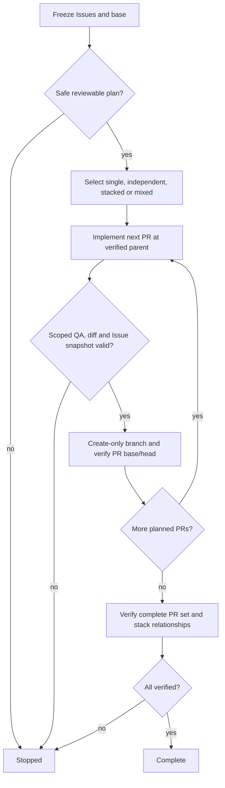

# Issue to PR

Implement one or more same-repository Issues as the smallest reviewable PR set. Use one PR by default, independent PRs for unrelated changes, and stacked PRs for dependent stages. Stop after creating and verifying all intended PRs; do not review or triage them.

For multi-PR plans, read and follow [references/multi-pr.md](references/multi-pr.md). If that required reference is inaccessible, return `STATUS: unsupported`.

## Invariants

- Freeze the requested Issue set, repository instructions, target base branch, and exact base SHA before planning.
- Respect an explicit multi-PR request. Otherwise split only at independently reviewable responsibility boundaries, never solely by size. Dependency edges must be acyclic, and each stack must be linear.
- Plan and implement against that frozen snapshot. If an Issue changes materially before commit, discard stale work, refresh the snapshot, and plan again.
- Isolate implementation from unrelated work. Bind each root PR to the frozen target base SHA and each dependent PR to its verified parent commit.
  Choose the edit mechanism supported by the client (such as a worktree,
  checkout, or commit-based API). Keep at most one active writer and changes
  within the accepted plan.
- Before commit, verify the implementation/base binding, final diff, Issue requirements, and required QA.
- Publish only fresh branches, atomically creating each remote ref only if absent; never reuse or overwrite an unexpected ref. Verify every ref points to its intended commit.
- Open and verify every PR's repository, base ref/SHA, head ref/SHA, and parent relationship. Preserve the exact PR set on partial failure; never claim an incomplete stack is complete.

## Planning

A ready plan must be decision-complete: scope, affected interfaces, implementation decisions, constraints, and verification. Decide `single`, `independent`, `stacked`, or `mixed` before editing. For each planned PR, record the owning Issues, responsibility, branch, parent PR (if any), expected base, and QA. Require a topological order and an explicit cap on PR count (default 5; caller may override). If an explicit split cannot be represented safely within that bound, stop rather than silently consolidate it.

If one material decision is missing, return only:

```text
STATUS: blocked
QUESTION: <smallest missing material decision>
```

## Procedure

1. Resolve all requested Issues and confirm they belong to one repository.
2. Freeze the Issue/base snapshot; select the PR mode and produce a decision-complete plan with explicit dependency edges.
3. In dependency order, prepare an isolated implementation at the frozen target base (roots) or verified parent head (stack layers).
4. Implement each layer and run scoped QA; validate that its parent-relative diff contains only its planned work.
5. Re-fetch all Issues before each commit; if requirements changed materially, discard stale unpublished work and replan. Validate the diff and QA, then commit.
6. Create each fresh remote branch with create-if-absent semantics and verify the commit; publish the PR with the planned base and verify its live base/head state.
7. For native stacks, link the verified chain using supported GitHub stack tooling and verify its membership. Otherwise explicitly report a branch-based PR chain without claiming native stack metadata.
8. Re-fetch the complete PR set and dependencies; finish only when all planned PRs and edges are verified. On partial publication, return `stopped` with the verified created PRs and exact recovery state.

## Flow



## Result

Return `STATUS: complete | stopped | unsupported`.

On success include the Issues, target base SHA, mode, ordered PR list (URL, base ref/SHA, head ref/SHA, parent, per-PR QA), and native-stack linkage status. In single-PR mode also retain the legacy `PR` and `PR head SHA` fields. On failure include the blocker, verified partial PRs/refs, and exact safe recovery or required user decision.
