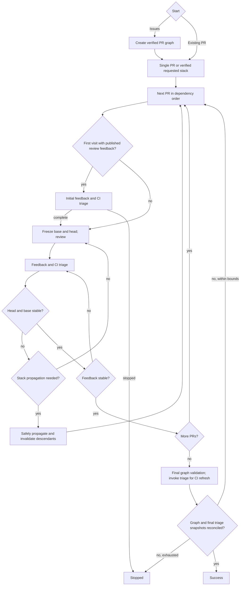

# PR Loop

Compose [`issue-to-pr`](../issue-to-pr/SKILL.md), [`pr-review`](../pr-review/SKILL.md), and [`pr-feedback-triage`](../pr-feedback-triage/SKILL.md). Each skill owns its standalone mechanics and safety checks; do not duplicate its review, feedback, or CI assessment. Work bottom-up through dependent PRs and separately through independent PRs.

Keep an explicit PR dependency graph, entry phase (`review` or `triage`), and phase (`review`, `triage`, `reconcile`, `done`) per PR. State the start mode and identifiers before the first tool call; report the verified graph and phase/restart changes as work proceeds. Run every required phase without asking for intermediate confirmation. Do not add unrelated changes, merge PRs, clear reviewer state, or wait for third-party reviews or CI.

## Procedure

1. **Resolve graph.** For Issues, run `issue-to-pr` on the complete Issue set and require its verified `STATUS: complete` PR graph. For an existing PR, process only that PR unless a requested stack's membership is verified.
2. **Choose entry phase.** On each PR's first visit, read all pages of submitted reviews and inline review comments. If any published review or inline feedback exists (including on older heads), start at step 4 (**Triage**); otherwise start at step 3 (**Review**). Pending reviews and review requests do not count. Make this choice only once per PR; subsequent restarts follow reconciliation, not the entry check.
3. **Review.** In dependency order, freeze each PR's base ref/SHA, head SHA, and published feedback. Run `pr-review` with publication enabled on that exact pair. Require `STATUS: reviewed`, `REVIEWED_HEAD` equal to the frozen head, and an unchanged live base/head after publication.
4. **Triage.** Run `pr-feedback-triage` on the live PR, including completed head and validated test-merge CI failures. Require `STATUS: complete`; retain its final head, feedback snapshot, and CI report, not its private CI assessment ledger. For dependent PRs, verify the base SHA before triage and again before every triage mutation; if its parent moved, propagate and re-review. If a pre-mutation base check is unavailable, return `unsupported`. After an entry triage, proceed to step 3 to review its resulting live base/head; existing GitHub reviews alone do not verify that exact pair. Keep triage's history and budgets across all invocations.
5. **Reconcile.** Re-fetch base/head and all feedback. If either SHA moved, invalidate the review, propagate affected stack changes (step 6), and review again. If only feedback changed, triage again. Otherwise require the latest reviewed base/head to equal the stable triage snapshot.
6. **Propagate stack changes.** After a lower layer's head changes, update descendants in order via a supported safe stack sync/rebase or explicit expected-SHA updates. Recheck each descendant's base/head, parent-relative diff, and QA; invalidate its previous review. Never silently force-push. Stop on conflicts, unexpected heads, or unavailable safe propagation.
7. **Final pass.** Re-fetch the entire graph. For each stable reviewed base/head pair, invoke triage once more to refresh final feedback and CI assessment under its existing history and remediation budget, then repeat step 5. Restart at the first invalidated PR when needed, within the bounds below. Complete only after all graph edges, review snapshots, final feedback, and assessed completed CI failures reconcile.

Do not poll pending/running checks or requested reviews. Triage published feedback, including comments on old heads, against the latest head. Treat feedback arriving after the final snapshot as next-run work. CI changes alone do not require re-review; new head/base or feedback does. A completed CI failure is a triage remediation candidate, not merely a merge-readiness warning.

## Flow

## Bounds and stopping

Caller/runtime limits override these independent defaults:

- Reviews: at most **3 rounds per PR**, including reviews invalidated by base changes.
- Triage: at most **9 state-change restarts per PR**, retained across invocations; triage separately owns its **3 CI remediation re-entries** per overall run.
- Multi-PR graph reconciliation: at most **3 full-graph passes**, including passes after propagation.

Stop when a required phase cannot complete, a limit is exhausted, a remote state change cannot be reconciled safely, feedback remains actionable, or an active `CHANGES_REQUESTED` review persists. Return `unsupported` when a mandatory capability or finite bound is unavailable. Open PRs and pending/failed/unknown CI alone do not preclude successful reconciliation; success does **not** imply CI passed, merge readiness, closed Issues, or permission to merge.

## Result

Return `success | stopped | unsupported` and the mode, ordered Issue/PR graph, each PR's entry phase, per-PR reviewed base/head SHAs, review rounds, final triage heads/restarts, propagation attempts, feedback blockers, CI status and failed-check URLs/remediation counts, and outstanding branch-protection, mergeability, deployment, and acceptance requirements. Preserve legacy single-PR fields for a single-PR run. Use triage's final CI observation boundary rather than maintaining a second CI ledger.
