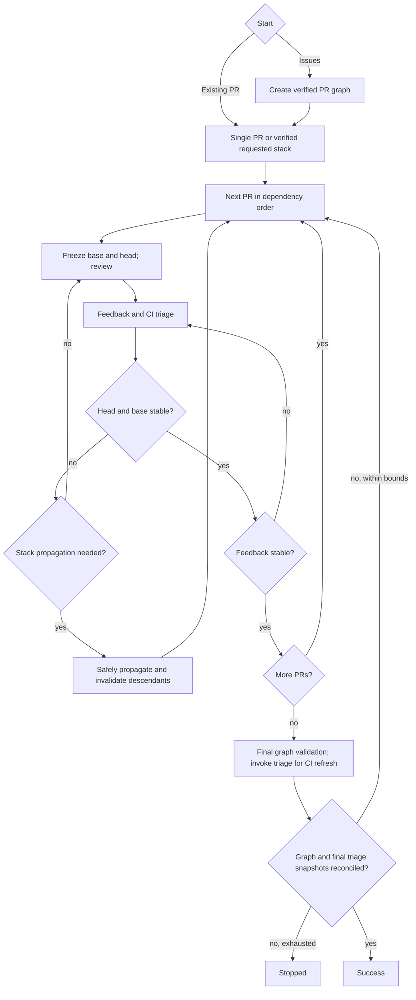

# PR Loop

Compose [`issue-to-pr`](../issue-to-pr/SKILL.md), [`pr-review`](../pr-review/SKILL.md), and [`pr-feedback-triage`](../pr-feedback-triage/SKILL.md) until every resulting PR has a reviewed, stable base/head snapshot, all observed feedback is triaged, and completed CI failures have been assessed for in-scope fixes. Dependent PRs are reconciled bottom-up; independent PRs are processed separately.

Each sibling owns its standalone mechanics and safety contract.

## Execution style

- Keep the PR graph and per-PR phase (`review`, `triage`, `reconcile`, `done`) in an explicit checklist and update it as you go.
- Run the loop to completion without asking for confirmation between phases. If any required review, triage, or reconciliation phase remains and no blocker is stated, take the next step instead of summarizing or offering to continue. Open PRs do not prevent success after all required phases are complete; merging is out of scope. Stop only for the `stopped`/`unsupported` conditions below, a missing user decision, or a risky or irreversible action that lacks authorization.
- Before the first tool call, state the requested start mode (Issues or existing PRs) and known identifiers in one line; report the verified PR graph once discovered. Add a short note when a PR changes phase or a restart or propagation occurs, in the same message as the next tool call, and finish with the Result report.
- Do not add reviews, fixes, files, or refactors beyond what a phase requires. Mention worthwhile extras in the final report instead of acting on them.

## Procedure

1. For an Issue start, run `issue-to-pr` on the full Issue set. Continue only after `STATUS: complete` with the complete verified PR graph. For an existing PR, retain the single-PR behavior unless the caller explicitly requests a stack and its membership can be verified.
2. Walk PRs in topological order (bottom-up within each stack). For each PR, snapshot its base ref/SHA, head SHA, and published feedback; retain this as `reviewed_target`.
3. Run `pr-review` on the frozen base/head snapshot with publication enabled. Continue only after `STATUS: reviewed` with `REVIEWED_HEAD` equal to the frozen head; re-fetch the PR to ensure both base and head still match.
4. Run `pr-feedback-triage` against the latest live PR state, including completed CI failures on its head and validated current test-merge target. Retain its exact final head, feedback snapshot, and final CI report. CI discovery, target validation, failure assessment, and bounded remediation belong to triage; do not inspect CI results or maintain a failure ledger in this skill. Continue only after `STATUS: complete`. For a dependent PR, first re-fetch its base and require it to equal the frozen base SHA, and re-check the base immediately before each triage mutation (fix push, reply, resolution). If the parent moved, stop that triage, propagate (step 6) and re-review instead; if the base cannot be checked before mutations, return `unsupported` for that PR.
5. Re-fetch the PR's base/head and complete feedback:
   - if head or base SHA changed, propagate affected stack changes as needed (step 6), then review the new pair again; count all repeated reviews against the per-PR review bound;
   - if feedback changed on a stable base/head, triage again;
   - otherwise, if state matches the retained triage snapshot and the base/head pair equals the latest reviewed pair, continue.

6. When a lower stack layer's head changes, propagate its changes into descendants in order, via supported stack rebase/sync or explicit expected-SHA updates. Never silently force-push. Revalidate each descendant's base, head, parent-relative diff, and QA; invalidate prior reviewed snapshots of descendants affected by the propagation. Stop on conflicts, unexpected remote heads, or unsupported safe propagation.
7. After all PRs reconcile, verify the entire PR graph and apply step 5 to each PR. For each stable reviewed pair, invoke triage again under step 4 to refresh its final feedback and CI report; triage retains its private assessment history and remediation budget within this overall run. Reapply step 5 after each invocation. Restart from the first invalidated PR if its base/head or feedback changed, subject to finite bounds. Stop for unresolved actionable feedback or active `CHANGES_REQUESTED` on any PR. Use each final triage snapshot as the CI observation boundary; later CI events belong to a later run.
8. Succeed only when every PR is reviewed at its final base/head pair, all observed feedback is reconciled, all stack edges still match the plan, and completed CI failures have been assessed for in-scope fixes.

Do not wait or poll for pending, running, or requested third-party reviews (including bots). Triage third-party feedback already published at the final snapshot, including comments on older heads, against the latest head. Feedback published after the final snapshot is for a later run.

Treat completed CI failures on the current head and validated test-merge target as remediation candidates during triage, not merely passive merge-readiness findings. Do not wait or poll for pending CI, and do not require newly triggered checks to finish before loop completion. Report final-head CI status (passed/failed/pending/unknown), unresolved failures, branch-protection requirements, mergeability, and deployment/acceptance checks separately; none implies permission to bypass protections, merge, or claim the PR or its Issue is complete.

Do not clear reviewer state merely to satisfy the loop.

## Flow

## Bounds

Keep review-round, triage-restart, and graph-reconciliation limits separate. Triage owns its CI remediation bound, including across final graph validation invocations. Caller/runtime values override defaults.

- review rounds: default maximum 3 per PR, including reviews invalidated by base changes;
- triage restarts: use `pr-feedback-triage`'s default maximum 9 per PR across invocations within this run;
- graph reconciliation passes: default maximum 3 for multi-PR runs, including repeated full-graph validation after propagation;

If an applicable bound is exhausted, stop. If a required finite bound or mandatory operation cannot be provided, return `unsupported`.

## Result

- `success`: every PR's current base/head pair and feedback equal its latest reviewed and triage-complete snapshot, and no unresolved actionable feedback or active `CHANGES_REQUESTED` review remains. Completed CI failures have been evaluated for in-scope fixes; success does not imply CI passed, mergeability, or closed Issues.
- `stopped`: a phase, unexpected state change, unsafe stack propagation, permission, exhausted bound, unresolved feedback, or active `CHANGES_REQUESTED` prevents success.
- `unsupported`: a required capability/resource or finite bound is unavailable.

Report the outcome, mode, ordered PR/Issue graph, per-PR reviewed base/head SHAs, review rounds, triage final heads/restarts, propagation attempts, feedback blockers, per-PR final-head `CI_STATUS`, failed check URLs/remediation attempts, triage-reported CI remediation counts, and outstanding merge or deployment/acceptance requirements separately. Preserve legacy single-PR fields for a single-PR run.
