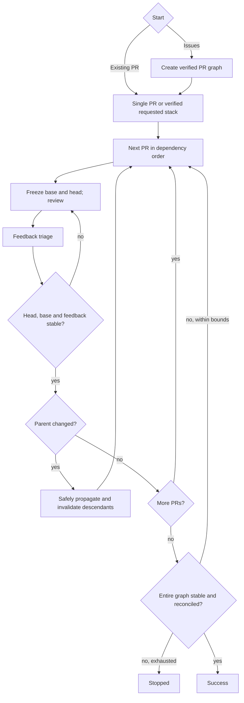

# PR Loop

Compose [`issue-to-pr`](../issue-to-pr/SKILL.md), [`pr-review`](../pr-review/SKILL.md), and [`pr-feedback-triage`](../pr-feedback-triage/SKILL.md) until every resulting PR has a reviewed, stable base/head snapshot and all observed feedback is triaged. Dependent PRs are reconciled bottom-up; independent PRs are processed separately.

Each sibling owns its standalone mechanics and safety contract.

## Procedure

1. For an Issue start, run `issue-to-pr` on the full Issue set. Continue only after `STATUS: complete` with the complete verified PR graph. For an existing PR, retain the single-PR behavior unless the caller explicitly requests a stack and its membership can be verified.
2. Walk PRs in topological order (bottom-up within each stack). For each PR, snapshot its base ref/SHA, head SHA, and published feedback; retain this as `reviewed_target`.
3. Run `pr-review` on the frozen base/head snapshot with publication enabled. Continue only after `STATUS: reviewed` with `REVIEWED_HEAD` equal to the frozen head; re-fetch the PR to ensure both base and head still match.
4. Run `pr-feedback-triage` against the latest live PR state; retain its final head and feedback snapshot. Continue only after `STATUS: complete`.
5. Re-fetch the PR's base/head and feedback. If feedback changed, triage again; if head or base SHA changed, review the new pair again. Count all repeated reviews against the per-PR review bound.
6. When a lower stack layer's head changes, propagate its changes into descendants in order, via supported stack rebase/sync or explicit expected-SHA updates. Never silently force-push. Revalidate each descendant's base, head, parent-relative diff, and QA; invalidate prior reviewed snapshots of descendants affected by the propagation. Stop on conflicts, unexpected remote heads, or unsupported safe propagation.
7. After all PRs reconcile, verify the entire PR graph, all stable base/head pairs, and final feedback snapshots again. Restart from the first invalidated PR if anything changed, subject to finite bounds. Stop for unresolved actionable feedback or active `CHANGES_REQUESTED` on any PR.
8. Succeed only when every PR is reviewed at its final base/head pair, all observed feedback is reconciled, and all stack edges still match the plan.

Do not wait or poll for pending, running, or requested third-party reviews (including bots). Triage third-party feedback already published at the final snapshot, including comments on older heads, against the latest head. Feedback published after the final snapshot is for a later run.

Treat CI failures, branch-protection requirements, mergeability, and deployment/acceptance checks as merge-readiness findings, not `pr-loop` completion blockers. Report them without bypassing protections, attempting an unauthorized merge, or claiming the PR or its Issue is complete.

Do not clear reviewer state merely to satisfy the loop.

## Flow

## Bounds

Keep review-round and triage-restart limits separate. Caller/runtime values override defaults.

- review rounds: default maximum 3 per PR, including reviews invalidated by base changes;
- triage restarts: use `pr-feedback-triage`'s default maximum 9 per PR;
- graph reconciliation passes: default maximum 3 for multi-PR runs, including repeated full-graph validation after propagation.

If an applicable bound is exhausted, stop. If a required finite bound or mandatory operation cannot be provided, return `unsupported`.

## Result

- `success`: every PR's current base/head pair and feedback equal its latest reviewed and triage-complete snapshot, and no unresolved actionable feedback or active `CHANGES_REQUESTED` review remains. This does not imply mergeability or closed Issues.
- `stopped`: a phase, unexpected state change, unsafe stack propagation, permission, exhausted bound, unresolved feedback, or active `CHANGES_REQUESTED` prevents success.
- `unsupported`: a required capability/resource or finite bound is unavailable.

Report the outcome, mode, ordered PR/Issue graph, per-PR reviewed base/head SHAs, review rounds, triage final heads/restarts, propagation attempts, feedback blockers, and outstanding CI, merge, or deployment/acceptance requirements separately. Preserve legacy single-PR fields for a single-PR run.
