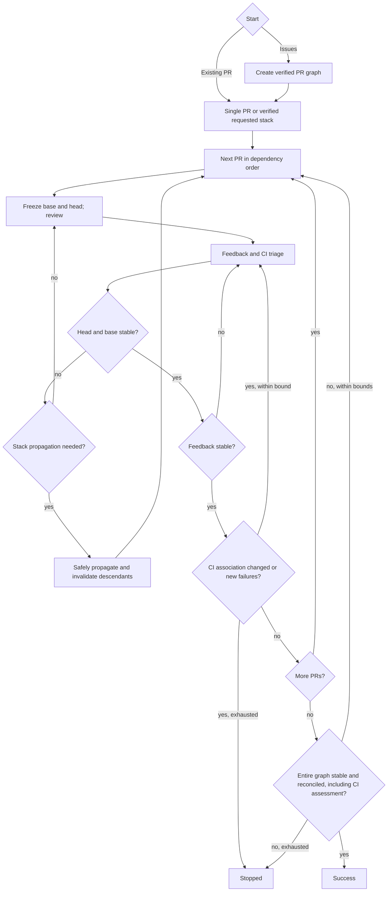

# PR Loop

Compose [`issue-to-pr`](../issue-to-pr/SKILL.md), [`pr-review`](../pr-review/SKILL.md), and [`pr-feedback-triage`](../pr-feedback-triage/SKILL.md) until every resulting PR has a reviewed, stable base/head snapshot, all observed feedback is triaged, and completed CI failures have been assessed for in-scope fixes. Dependent PRs are reconciled bottom-up; independent PRs are processed separately.

Each sibling owns its standalone mechanics and safety contract.

## Procedure

1. For an Issue start, run `issue-to-pr` on the full Issue set. Continue only after `STATUS: complete` with the complete verified PR graph. For an existing PR, retain the single-PR behavior unless the caller explicitly requests a stack and its membership can be verified.
2. Walk PRs in topological order (bottom-up within each stack). For each PR, snapshot its base ref/SHA, head SHA, and published feedback; retain this as `reviewed_target`.
3. Run `pr-review` on the frozen base/head snapshot with publication enabled. Continue only after `STATUS: reviewed` with `REVIEWED_HEAD` equal to the frozen head; re-fetch the PR to ensure both base and head still match.
4. Run `pr-feedback-triage` against the latest live PR state, including completed CI failures on its head and validated current test-merge target. Retain its exact final head, feedback snapshot, reported effective CI status, head/base/merge target association, and ledger of assessed failure identities/attempts. Continue only after `STATUS: complete`. For a dependent PR, first re-fetch its base and require it to equal the frozen base SHA, and re-check the base immediately before each triage mutation (fix push, reply, resolution). If the parent moved, stop that triage, propagate (step 6) and re-review instead; if the base cannot be checked before mutations, return `unsupported` for that PR.
5. Re-fetch the PR's base/head, complete feedback, merge association, and CI results on the validated head/test-merge targets using the triage CI contract:
   - if head or base SHA changed, propagate affected stack changes as needed (step 6), then review the new pair again; count all repeated reviews against the per-PR review bound;
   - if feedback changed on a stable base/head, triage again;
   - if base/head and feedback match but the merge association changed, re-enter triage within the CI re-entry bound to invalidate stale assessments and refresh the target association;
   - if base/head and feedback match but newly completed applicable failures are absent from the retained assessment ledger, re-enter triage for those failures within the CI re-entry bound, then refresh the retained snapshot and ledger;
   - otherwise, if state matches the retained triage snapshot and the base/head pair equals the latest reviewed pair, continue.

   Compare failures by PR head/base and validated merge association, actual CI target SHA, and check run ID/attempt or external status context/ID. Already assessed failures, including unfixable failures, do not trigger re-entry. Observe CI only at these state checks; never wait or poll for pending checks.

6. When a lower stack layer's head changes, propagate its changes into descendants in order, via supported stack rebase/sync or explicit expected-SHA updates. Never silently force-push. Revalidate each descendant's base, head, parent-relative diff, and QA; invalidate prior reviewed snapshots of descendants affected by the propagation. Stop on conflicts, unexpected remote heads, or unsupported safe propagation.
7. After all PRs reconcile, verify the entire PR graph, all stable base/head pairs, final feedback snapshots, and CI evidence again. Apply the step 5 state checks and CI re-entry bound for each PR. Restart from the first invalidated PR if anything changed, subject to finite bounds. Stop for unresolved actionable feedback or active `CHANGES_REQUESTED` on any PR.
8. Succeed only when every PR is reviewed at its final base/head pair, all observed feedback is reconciled, all stack edges still match the plan, and completed CI failures have been assessed for in-scope fixes.

Do not wait or poll for pending, running, or requested third-party reviews (including bots). Triage third-party feedback already published at the final snapshot, including comments on older heads, against the latest head. Feedback published after the final snapshot is for a later run.

Treat completed CI failures on the current head and validated test-merge target as remediation candidates during triage, not merely passive merge-readiness findings. Do not wait or poll for pending CI, and do not require newly triggered checks to finish before loop completion. Report final-head CI status (passed/failed/pending/unknown), unresolved failures, branch-protection requirements, mergeability, and deployment/acceptance checks separately; none implies permission to bypass protections, merge, or claim the PR or its Issue is complete.

Do not clear reviewer state merely to satisfy the loop.

## Flow

## Bounds

Keep review-round, triage-restart, graph-reconciliation, and CI re-entry limits separate. Caller/runtime values override defaults.

- review rounds: default maximum 3 per PR, including reviews invalidated by base changes;
- triage restarts: use `pr-feedback-triage`'s default maximum 9 per PR;
- graph reconciliation passes: default maximum 3 for multi-PR runs, including repeated full-graph validation after propagation;
- CI re-entries: default maximum 3 per overall loop run, separate from snapshot restarts and not reset by head, base, merge-target changes, stack propagation, or graph reconciliation passes. Stop and report unassessed failures when exhausted.

If an applicable bound is exhausted, stop. If a required finite bound or mandatory operation cannot be provided, return `unsupported`.

## Result

- `success`: every PR's current base/head pair and feedback equal its latest reviewed and triage-complete snapshot, and no unresolved actionable feedback or active `CHANGES_REQUESTED` review remains. Completed CI failures have been evaluated for in-scope fixes; success does not imply CI passed, mergeability, or closed Issues.
- `stopped`: a phase, unexpected state change, unsafe stack propagation, permission, exhausted bound, unresolved feedback, or active `CHANGES_REQUESTED` prevents success.
- `unsupported`: a required capability/resource or finite bound is unavailable.

Report the outcome, mode, ordered PR/Issue graph, per-PR reviewed base/head SHAs, review rounds, triage final heads/restarts, propagation attempts, feedback blockers, per-PR final-head `CI_STATUS`, failed check URLs/remediation attempts, CI re-entry counts, and outstanding merge or deployment/acceptance requirements separately. Preserve legacy single-PR fields for a single-PR run.
